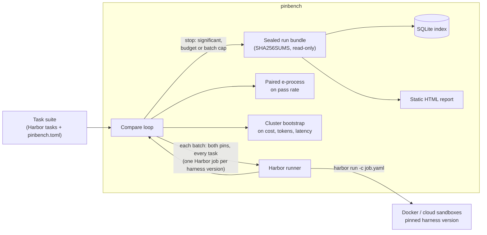

# pinbench

[](https://github.com/digitalinnovator/pinbench/actions/workflows/ci.yml)

**Find out whether a Claude Code or Codex update made your coding agent worse, or more expensive, on *your* tasks.**

pinbench re-runs your own task suite against pinned versions of a coding-agent harness and model. It stops as soon as a regression in pass rate is statistically clear, and reports cost, token and latency changes with confidence intervals. It composes [Harbor](https://github.com/harbor-framework/harbor) for sandboxed execution and adds the missing layer on top: version pinning, sequential statistics, budgets and immutable evidence.

> **Status: pre-alpha (0.1.0).** Built and run against real harnesses: Claude Code (several versions, three models) and Codex, through Harbor in Docker. OpenCode is not supported yet. A first benchmark campaign is below. See the [roadmap](docs/roadmap.md).


*The simulated demo from the Quickstart (no keys, no spend), with its per-batch log lines condensed. Rendered by [`scripts/make_demo_gif.py`](scripts/make_demo_gif.py).*

## Why

Anthropic's [2026-04-23 postmortem](https://www.anthropic.com/engineering/april-23-postmortem) traced weeks of Claude Code quality complaints to three **harness-layer** changes: a lower default reasoning effort, a thinking-block caching bug, and a verbosity system-prompt change. It stated that the API and model weights were unaffected. Trackers that watch only models miss that class of regression. Public trackers run their tasks, not yours. Vendors are poorly placed to referee their own releases.

## Headline benchmark

One pre-registered campaign on pinbench's own [benchmark suite](examples/benchmark-suite/) (32 tasks; the runs below used 10 or 18 of them), October 2026, for $22.80 of API credit ($19.75 Anthropic, $3.05 OpenAI). Every number in this section is printed from committed evidence by [`benchmarks/campaign_report.py`](benchmarks/campaign_report.py) into [`campaign-2026-10.md`](benchmarks/results/campaign-2026-10.md); the [campaign log](docs/benchmark/campaign-log.md) has each step and its gates. Run records name commits by their IDs from before a 2026-10-21 cleanup of the history; [commit-map.md](docs/benchmark/commit-map.md) maps them to the current ones.

| Injected regression (postmortem analogue) | Harness and model | Result | Trials | Cost |
|---|---|---|---|---|
| Reasoning effort high → low (default effort lowered, 4 March) | Claude Code 2.1.283, Sonnet 5, 10 tasks | Pass rate 63% → 45%. **Not flagged** by the anytime-valid test (E = 11.3 against 20). A one-look test at the pre-registered 5 batches gives p = 0.025 | 120 | $13.00 |
| | | Cost ×0.62, output ×0.42, agent time ×0.65 (all 95% intervals exclude 1) | | |
| Prompt caching off (thinking-block caching bug, 26 March) | Claude Code 2.1.283, Haiku 4.5, 6 tasks | **Cost ×2.63, flagged** (95% interval 1.75–4.10) after one batch | 12 | $1.75 |
| Reasoning effort high → none, replicated 5 times | Codex 0.163.0, `gpt-6-luna`, 18 tasks | Pass rate 98% → 59%. **Flagged in 5 of 5 runs**, after a median of 72 trials and $0.29 | 324 | $1.32 |
| Identical arms (no regression), 2 runs | Codex 0.163.0, `gpt-6-luna`, 18 tasks | **Flagged in 0 of 2 runs**; both stopped at the futility look | 216 | $1.09 |
| Verbosity instruction (system-prompt change, 16 April) | Claude Code 2.1.283, Haiku 4.5, 3 tasks | Pass rate 24/24 → 23/24. **Not flagged** (E = 1.3). Output tokens ×1.15, cost ×1.04; both intervals include 1 | 48 | $1.30 |

Read it this way:

- **The cost regression is caught cheaply. The pass-rate regression, at this size, is not.** An 18-point drop on 10 tasks took the sequential test to E = 11.3 after 6 batches. Flagging a drop this size needs more batches or a larger suite than this budget allowed. The price of being allowed to look after every batch is needing more evidence than a test that looks once.
- **The Claude Code result is one run, not a detection rate.** It shows what pinbench concluded on one budget, not how often it would. Its sixth batch was a planned leftover-budget step, but it ran before the caching check rather than after it as the plan ordered; the result is not flagged at 5 batches or at 6.
- **The Codex replication is a detection rate, for a much larger drop.** Codex trials cost about $0.004, so the same protocol ran five times: every run flagged a 39-point drop within one or two batches, for under $0.31 each. Five of five still allows a true rate as low as 48% (95% interval), and the two identical-arm runs say little about false alarms; the test's guarantee (at most 5%) does.
- **The verbosity stand-in did not reproduce a regression.** Appending "keep every response under 25 words" changed neither the pass rate nor the output measurably on Haiku 4.5, probably because most of a coding agent's output is code and tool calls, not prose. The real 16 April change may have acted differently; this is one stand-in on 3 easy tasks.
- **Lower effort claimed "tests pass" more often and was wrong more often, on both harnesses.** Sonnet 5 at low effort claimed it in 55 of 60 trials and then failed the hidden tests in 29; at high effort, 33 claims and 9 such failures. Codex at effort none claimed it in 146 of 162 trials, with 61 hidden-test failures; at high effort, 82 claims in 270 trials and 2 failures. Almost every claim was backed by a passing test run after the last edit: the agents' own checks were weaker than the hidden tests.
- **The verifier flagged 6 Codex claims in the replicated runs**, 3 at each effort level: each time the agent edited after its last test run and then said the tests passed. A hand check of all six is in the [campaign log](docs/benchmark/campaign-log.md).

Also verified on real trials:

- **Every knob reaches the harness.** Effort, appended system prompt, caching off, turn cap and dollar cap; both caps stop a trial and keep its cost.
- **Re-priced cost matches the harness's own figure** on 879 of 882 trials, for Sonnet 5, Haiku 4.5 and `gpt-6-luna`. Three Sonnet 5 trials re-priced 4–14% lower; the cause is not yet known.
- **A real release check works.** 2.1.283 against 2.1.303, one Harbor job per version, each trial proving its version from its own transcript.
- **The March–April 2026 builds (2.1.66, 2.1.85, 2.1.112) still run** against today's API.
- **Codex 0.163.0 runs through pinbench** on `gpt-6-luna` at about $0.005 a trial. It solved 63 of 64 attempts at high effort and 60 of 64 at low on all 32 tasks, so this suite (tuned against Sonnet 5) has no headroom for that cut; hence effort none in the replication. Low effort still cut Codex's cost to ×0.58 and its time to ×0.64.

The design behind these numbers is in the [benchmark plan](docs/benchmark/plan.md). A free [pre-screen](docs/benchmark/prescreen.md) chose the tasks before any trial was paid for.

## Quickstart

From a checkout, with [uv](https://docs.astral.sh/uv/) installed:

```bash
make dev                                                        # pinbench env + hash-locked Harbor env
uv run pinbench compare stable regressed -c examples/simulated    # simulated: no Docker, no keys; its dollars are simulated
open examples/simulated/.pinbench/reports/*.html                  # the report
```

Against real sandboxes (needs Docker; oracle and nop spend nothing):

```bash
uv run pinbench compare oracle nop -c examples/demo-suite
```

Against Claude Code (spends API credit; each trial is capped by `max_budget_usd`). Put your key in a gitignored `.env`:

```bash
uv run pinbench compare cc-baseline cc-low-effort -c examples/demo-suite --env-file .env
```

`pinbench compare` exits with 1 when it detects a regression, so it can gate a CI job.

Real runs are refused until you set a lifetime spending limit for the credit pool they draw on. Every batch reserves its worst case against that limit before it starts ([ADR-0009](docs/adr/0009-spending-guardrails.md)):

```bash
uv run pinbench ledger limit anthropic 20                                        # total this machine may ever spend
uv run pinbench compare cc-baseline cc-low-effort -c examples/demo-suite --dry-run   # what it could cost; spends nothing
uv run pinbench ledger status
```

On a schedule, test each new harness release once and alert on a regression:

```bash
uv run pinbench watch -c examples/demo-suite          # is there a newer release than the baseline pin? (no spend)
uv run pinbench watch --run -c examples/demo-suite    # compare baseline vs the same pin at the new version
```

[`examples/ci/pinbench.yml`](examples/ci/pinbench.yml) is an example daily GitHub Actions job that does this from a clone of this repository; it has not yet run on GitHub. Alerts go to a Slack webhook and a GitHub issue ([ADR-0008](docs/adr/0008-triggers-and-alerts.md)), so far tested against fake services only; preview one with `pinbench alert <run> --dry-run -c <suite>`.

## How it works



- **Pins are cells of a version matrix.** A pin is harness × exact version × model × options × env, identified by a fingerprint. Compare two pins that differ in one dimension and a regression is attributed to that dimension. Config files (CLAUDE.md, MCP config) are fingerprinted but not yet delivered to the sandbox, so pinbench refuses two pins that differ only in them.
- **Paired and concurrent.** Each batch runs every task on both pins in the same Harbor job. Pairing removes task-difficulty variance. Running both arms together controls for API drift during the day.
- **Stops early, safely.** The pass-rate test is a mixture e-process on discordant pairs. Checking it after every batch does not inflate the false-alarm rate ([ADR-0003](docs/adr/0003-sequential-paired-statistics.md)). With the defaults (α = 0.05, mixture bound 0.8) it needs at least 10 discordant pairs to flag anything. The mixture bound was chosen by a [power simulation](benchmarks/results/power-simulation.md), which also shows that re-checking a fixed-sample test after every batch gives 14–19% false alarms instead of 5%.
- **Catches false success.** A rule-based verifier reads each transcript and checks every "tests pass" claim against the agent's own test-runner output after its last edit. No model is involved ([ADR-0007](docs/adr/0007-verifier-lite.md)). `pinbench claims <run>` re-scores any stored run.
- **Spending is capped.** A campaign ledger holds a lifetime limit per credit pool across all runs. A batch starts only if its worst case fits, unknown costs count at the cap, and a run stops when the account is empty or a batch yields nothing ([ADR-0009](docs/adr/0009-spending-guardrails.md)).
- **Evidence you can audit.** Every run is a bundle holding the manifest (task digests, pin fingerprints, Harbor version, settings), raw Harbor trial directories, normalised trials and the verdict. The bundle is checksummed and made read-only ([ADR-0004](docs/adr/0004-run-bundles-and-index.md)).

Architecture: [C4 context](docs/architecture/c4-context.md) · [C4 containers and data model](docs/architecture/c4-container.md) · [ADRs](docs/adr/).

## Configuration sketch

```toml
[suite]
name = "my-team"
tasks_dir = "tasks"            # Harbor task format: task.toml, instruction.md, environment/, tests/

[budget]
max_usd = 20.0                 # checked before each batch against the average batch cost so far
max_batches = 10
attempts_per_batch = 1

[pins.current]
harness = "claude-code"
version = "2.1.283"            # exact versions only; drift between pin and installed version fails the run
model = "anthropic/claude-opus-5"
options = { reasoning_effort = "high", max_budget_usd = "1.00" }

[pins.next]
harness = "claude-code"
version = "2.1.284"
model = "anthropic/claude-opus-5"
options = { reasoning_effort = "high", max_budget_usd = "1.00" }
```

## Limitations (read before trusting a number)

- The harness under test is the harness **as Harbor launches it**: headless print mode, permissions bypassed. That is right for regression detection, and it is not your interactive setup.
- Cost is **re-priced from token usage** with a dated price table in this repo, so a harness that changes its bundled prices does not look like a regression ([ADR-0005](docs/adr/0005-cost-normalisation.md)). The table covers Anthropic and OpenAI models at first-party API prices; anything else falls back to the harness's own estimate and the report says so.
- **Prompt-cache state moves cost.** A configuration's first trials pay a cache write that later ones do not. On small suites set `[stats] warmup_batches = 1`, and read a cost ratio together with `cache_write_tokens`.
- Cost and latency intervals are fixed-sample at the stopping time and are too narrow with fewer than about 20 tasks.
- The false-success check favours precision: it misses hedged or unusual claims, reads test-runner output and not exit codes, and is verified on Claude Code and Codex transcripts only.
- Tasks that always pass or always fail cost money and add no evidence. The report shows which tasks were discordant.
- **OpenCode is not supported yet.** Harbor has an adapter, but its version proof would be hollow (Harbor echoes the requested version) and pinbench has never run it.
- **Alerts and the CI example have not run against real services.** Slack and GitHub-issue alerts are tested against fake services; the scheduled workflow has not run on GitHub.
- **Harbor 0.23.0 did not enforce the agent timeout for Codex:** two trials ran 23 and 39 minutes under a 300-second limit. Waiting costs no tokens, and pinbench's batch watchdog and ledger still bound the run, but a trial can take far longer than configured.

## Alternatives

A dated comparison, re-checked on 2026-10-21 against each project's own source, is in [docs/research/2026-10-21-competitive-recheck.md](docs/research/2026-10-21-competitive-recheck.md). Every piece of this project now exists somewhere; the combination does not. In short:

- **[UiPath/coder_eval](https://github.com/UiPath/coder_eval)** is the closest in practice: your own tasks, several harnesses, a Harbor export, re-priced cost and fixed-sample statistics. It has no release triggers, no sequential test and no alerts.
- **[dshakes/halos](https://github.com/dshakes/halos)** is the closest in concept: a harness × version × model matrix, npm release watching and a paired bootstrap on a private suite. Its sequential test applies to live traffic, not to the suite.
- **[config-drift-checker](https://github.com/jameskomo/config-drift-checker)** watches Claude Code releases against config-level evals (FSL licence).
- **[Harbor](https://github.com/harbor-framework/harbor)** is the runner this project builds on; its statistics are still in open pull requests.
- **[arbiter](https://github.com/TITANS-COVENANT/arbiter)** gates CI with a sequential McNemar test, without harness adapters, triggers or cost.
- **[Promptfoo](https://github.com/promptfoo/promptfoo)** (owned by OpenAI) and Anthropic's `claude plugin eval` are vendor tooling; this project measures harnesses without belonging to a vendor whose harness it measures.
- **MarginLab and AIStupidLevel** track public suites or models, not your tasks on pinned harness versions.

What this project combines in one Apache-2.0 tool: private suites; exact pinned versions of Claude Code and Codex through Harbor; release and cron triggers; an anytime-valid test on suite pass rate; intervals on re-priced cost; a deterministic "tests pass" verifier; a lifetime spending ledger; checksummed run bundles; alerts. Re-verify before relying on this: the space moves weekly.

## Roadmap

Next: an OpenCode adapter with real version proof, config files delivered into the sandbox, a cheaper "history mode" that compares against stored baseline runs, and a monthly harness efficiency index. The full list, with known limitations, is in [docs/roadmap.md](docs/roadmap.md).

## Contributing

```bash
make dev && make check     # ruff, mypy --strict, pytest
make docker-test           # real Harbor trials with the zero-cost oracle and nop agents
```

Record significant decisions as ADRs in `docs/adr/`. Keep v0.1 narrow and park ideas in `docs/roadmap.md`. To report a security problem, see [SECURITY.md](SECURITY.md).

## License

[Apache-2.0](LICENSE).
