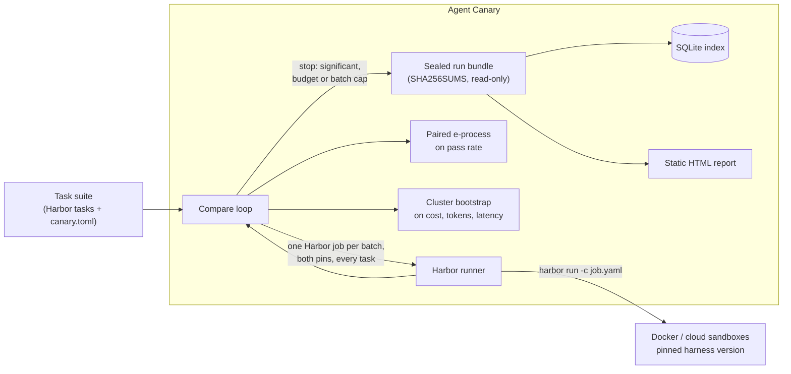

# Agent Canary (working name)

**Know within a day whether Claude Code, Codex or OpenCode got worse, or more expensive, on *your* tasks.**

Agent Canary re-runs your own task suite against pinned versions of a coding-agent harness and model. It stops as soon as a regression in pass rate is statistically clear, and reports cost, token and latency changes with confidence intervals. It composes [Harbor](https://github.com/harbor-framework/harbor) for sandboxed execution and adds the missing layer on top: version pinning, sequential statistics, budgets and immutable evidence.

> **Status: pre-alpha, local development only.** The vertical slice works end to end: suite → paired runs → statistics → sealed bundle → index → report. No benchmark numbers are published yet. See the [roadmap](docs/roadmap.md).

<!-- Demo GIF goes here once the Claude Code spike has run (docs/spikes/0001-harbor-claude-code.md). -->

## Why

Anthropic's [2026-04-23 postmortem](https://www.anthropic.com/engineering/april-23-postmortem) traced weeks of Claude Code quality complaints to three **harness-layer** changes: a lower default reasoning effort, a thinking-block caching bug, and a verbosity system-prompt change. It stated that the API and model weights were unaffected. Trackers that watch only models miss that class of regression. Public trackers run their tasks, not yours. Vendors are poorly placed to referee their own releases.

## Headline benchmark

*Not yet published.* A [power simulation](benchmarks/results/power-simulation.md) (simulated, not measured) sizes it. The planned regression-injection benchmark injects the three postmortem failure types into a pinned Claude Code (`examples/demo-suite/canary.toml` has the injection pins). It then reports how many runs and dollars it takes to flag each regression at 95% confidence. Every number here will come from a committed benchmark script.

## Quickstart

From a checkout, with [uv](https://docs.astral.sh/uv/) installed:

```bash
make dev                                                        # canary env + hash-locked Harbor env
uv run canary compare stable regressed -c examples/simulated    # simulated: no Docker, no keys, no spend
open examples/simulated/.canary/reports/*.html                  # the report
```

Against real sandboxes (needs Docker; oracle and nop spend nothing):

```bash
uv run canary compare oracle nop -c examples/demo-suite
```

Against Claude Code (spends API credit; each trial is capped by `max_budget_usd`). Put your key in a gitignored `.env`:

```bash
uv run canary compare cc-baseline cc-low-effort -c examples/demo-suite --env-file .env
```

`canary compare` exits with 1 when it detects a regression, so it can gate a CI job.

## How it works



- **Pins are cells of a version matrix.** A pin is harness × exact version × model × options × env × config files, identified by a fingerprint. Compare two pins that differ in one dimension and a regression is attributed to that dimension.
- **Paired and concurrent.** Each batch runs every task on both pins in the same Harbor job. Pairing removes task-difficulty variance. Running both arms together controls for API drift during the day.
- **Stops early, safely.** The pass-rate test is a mixture e-process on discordant pairs. Checking it after every batch does not inflate the false-alarm rate ([ADR-0003](docs/adr/0003-sequential-paired-statistics.md)). With the defaults (α = 0.05, mixture bound 0.8) it needs at least 10 discordant pairs to flag anything. The mixture bound was chosen by a [power simulation](benchmarks/results/power-simulation.md), which also shows that re-checking a fixed-sample test after every batch gives 14–19% false alarms instead of 5%.
- **Evidence you can audit.** Every run is a bundle holding the manifest (task digests, pin fingerprints, Harbor version, settings), raw Harbor trial directories, normalised trials and the verdict. The bundle is checksummed and made read-only ([ADR-0004](docs/adr/0004-run-bundles-and-index.md)).

Architecture: [C4 context](docs/architecture/c4-context.md) · [C4 containers and data model](docs/architecture/c4-container.md) · [ADRs](docs/adr/).

## Configuration sketch

```toml
[suite]
name = "my-team"
tasks_dir = "tasks"            # Harbor task format: task.toml, instruction.md, environment/, tests/

[budget]
max_usd = 20.0                 # checked before each batch against the average batch cost so far
max_batches = 10
attempts_per_batch = 1

[pins.current]
harness = "claude-code"
version = "2.1.283"            # exact versions only; drift between pin and installed version fails the run
model = "anthropic/claude-opus-5"
options = { reasoning_effort = "high", max_budget_usd = "1.00" }

[pins.next]
harness = "claude-code"
version = "2.1.284"
model = "anthropic/claude-opus-5"
options = { reasoning_effort = "high", max_budget_usd = "1.00" }
```

## Limitations (read before trusting a number)

- The harness under test is the harness **as Harbor launches it**: headless print mode, permissions bypassed. That is right for regression detection, and it is not your interactive setup.
- Cost is **harness-reported**. Harnesses estimate cost from their own bundled price tables, so across harness versions compare tokens first. Re-pricing from tokens is [ADR-0005](docs/adr/0005-cost-normalisation.md) (proposed).
- Cost and latency intervals are fixed-sample at the stopping time and are too narrow with fewer than about 20 tasks.
- Tasks that always pass or always fail cost money and add no evidence. The report shows which tasks were discordant.

## Alternatives

A dated comparison, re-checked on 2026-09-27, is in [docs/research/2026-09-27-competitive-recheck.md](docs/research/2026-09-27-competitive-recheck.md). In short:

- **Harbor and Margin Eval** are runners. This project builds on Harbor rather than competing with it.
- **MarginLab** tracks a public SWE-Bench-Pro subset.
- **UiPath coder_eval** runs A/B experiments on your own tasks with fixed-sample statistics.
- **config-drift-checker** watches Claude Code releases against config-level evals.

No project found combines private suites, a harness-version matrix, sequential stopping, cost intervals and Apache-2.0 licensing. Re-verify before relying on this: the space moves weekly.

## Contributing

```bash
make dev && make check     # ruff, mypy --strict, pytest
make docker-test           # real Harbor trials with the zero-cost oracle and nop agents
```

Record significant decisions as ADRs in `docs/adr/`. Keep v0.1 narrow and park ideas in `docs/roadmap.md`.

## License

[Apache-2.0](LICENSE).
