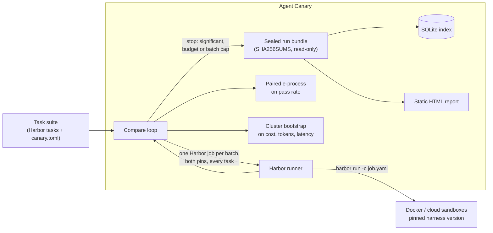

# Agent Canary (working name)

**Know within a day whether Claude Code, Codex or OpenCode got worse, or more expensive, on *your* tasks.**

Agent Canary re-runs your own task suite against pinned versions of a coding-agent harness and model. It stops as soon as a regression in pass rate is statistically clear, and reports cost, token and latency changes with confidence intervals. It composes [Harbor](https://github.com/harbor-framework/harbor) for sandboxed execution and adds the missing layer on top: version pinning, sequential statistics, budgets and immutable evidence.

> **Status: pre-alpha, local development only.** Everything in the v0.1 scope is built and has run against real harnesses: Claude Code (several versions, three models) and Codex, through Harbor in Docker. A first benchmark campaign is below. See the [roadmap](docs/roadmap.md).

<!-- Demo GIF goes here once the Claude Code spike has run (docs/spikes/0001-harbor-claude-code.md). -->

## Why

Anthropic's [2026-04-23 postmortem](https://www.anthropic.com/engineering/april-23-postmortem) traced weeks of Claude Code quality complaints to three **harness-layer** changes: a lower default reasoning effort, a thinking-block caching bug, and a verbosity system-prompt change. It stated that the API and model weights were unaffected. Trackers that watch only models miss that class of regression. Public trackers run their tasks, not yours. Vendors are poorly placed to referee their own releases.

## Headline benchmark

One pre-registered campaign on the canary's own [18-task suite](examples/benchmark-suite/), October 2026, on a fixed budget of about $20 of API credit. Every number below is rebuilt from committed evidence by [`benchmarks/campaign_report.py`](benchmarks/campaign_report.py) into [`campaign-2026-10.md`](benchmarks/results/campaign-2026-10.md); the [campaign log](docs/benchmark/campaign-log.md) has each step and its gates.

| Injected regression (postmortem analogue) | Harness and model | Result | Trials | Cost |
|---|---|---|---|---|
| Reasoning effort high → low (default effort lowered, 4 March) | Claude Code 2.1.283, Sonnet 5, 10 tasks | Pass rate 63% → 45%. **Not flagged** by the anytime-valid test (E = 11.3 against 20). A one-look test at the pre-registered 5 batches gives p = 0.025 | 120 | $13.00 |
| | | Cost ×0.62, output ×0.42, agent time ×0.65 (all 95% intervals exclude 1) | | |
| Prompt caching off (thinking-block caching bug, 26 March) | Claude Code 2.1.283, Haiku 4.5, 6 tasks | **Cost ×2.63, flagged** (95% interval 1.75–4.10) after one batch | 12 | $1.75 |

Read it this way:

- **The cost regression is caught cheaply. The pass-rate regression, at this size, is not.** An 18-point drop on 10 tasks took the sequential test to E = 11.3 after 6 batches. At the observed rates it needs about 10 batches (about $22) to flag 80% of the time (simulated). The price of being allowed to look after every batch is needing more evidence than a test that looks once.
- **This is one run, not a detection rate.** It shows what the canary concluded on one budget, not how often it would.
- **The real harness showed about 0.6 of the effect** that a free pre-screen predicted (18 points against about 31), with the same baseline difficulty (67% against 66%).
- **Low effort claimed "tests pass" far more often and was wrong far more often.** It claimed so in 55 of 60 trials and then failed the hidden tests in 29 of them; high effort claimed it 33 times, with 9 such failures. None of these claims was false by the verifier's rule (each had a passing test run after the last edit): the agent's own checks were weaker than the hidden tests.

Also verified on real trials:

- **Every knob reaches the harness.** Effort, appended system prompt, caching off, turn cap and dollar cap; both caps stop a trial and keep its cost.
- **Re-priced cost equals harness-reported cost** on every trial, for Opus 5, Sonnet 5, Haiku 4.5 and `gpt-6-luna`.
- **A real release check works.** 2.1.283 against 2.1.303, one Harbor job per version, each trial proving its version from its own transcript.
- **The March–April 2026 builds (2.1.66, 2.1.85, 2.1.112) still run** against today's API.
- **Codex 0.163.0 runs through the canary** on `gpt-6-luna` at about $0.005 a trial. It solved 63 of 64 attempts at high effort and 60 of 64 at low on all 32 tasks, so this suite (tuned against Sonnet 5) has no headroom for it. Low effort still cut Codex's cost to ×0.58 and its time to ×0.64.

The design behind these numbers is in the [benchmark plan](docs/benchmark/plan.md). A free [pre-screen](docs/benchmark/prescreen.md) chose the tasks before any trial was paid for.

## Quickstart

From a checkout, with [uv](https://docs.astral.sh/uv/) installed:

```bash
make dev                                                        # canary env + hash-locked Harbor env
uv run canary compare stable regressed -c examples/simulated    # simulated: no Docker, no keys, no spend
open examples/simulated/.canary/reports/*.html                  # the report
```

Against real sandboxes (needs Docker; oracle and nop spend nothing):

```bash
uv run canary compare oracle nop -c examples/demo-suite
```

Against Claude Code (spends API credit; each trial is capped by `max_budget_usd`). Put your key in a gitignored `.env`:

```bash
uv run canary compare cc-baseline cc-low-effort -c examples/demo-suite --env-file .env
```

`canary compare` exits with 1 when it detects a regression, so it can gate a CI job.

Real runs are refused until you set a lifetime spending limit for the credit pool they draw on. Every batch reserves its worst case against that limit before it starts ([ADR-0009](docs/adr/0009-spending-guardrails.md)):

```bash
uv run canary ledger limit anthropic 20                                        # total this machine may ever spend
uv run canary compare cc-baseline cc-low-effort -c examples/demo-suite --dry-run   # what it could cost; spends nothing
uv run canary ledger status
```

On a schedule, test each new harness release once and alert on a regression:

```bash
uv run canary watch -c examples/demo-suite          # is there a newer release than the baseline pin? (no spend)
uv run canary watch --run -c examples/demo-suite    # compare baseline vs the same pin at the new version
```

[`examples/ci/agent-canary.yml`](examples/ci/agent-canary.yml) is a daily GitHub Actions job that does this. Alerts go to a Slack webhook and a GitHub issue ([ADR-0008](docs/adr/0008-triggers-and-alerts.md)); preview one with `canary alert <run> --dry-run`.

## How it works



- **Pins are cells of a version matrix.** A pin is harness × exact version × model × options × env × config files, identified by a fingerprint. Compare two pins that differ in one dimension and a regression is attributed to that dimension.
- **Paired and concurrent.** Each batch runs every task on both pins in the same Harbor job. Pairing removes task-difficulty variance. Running both arms together controls for API drift during the day.
- **Stops early, safely.** The pass-rate test is a mixture e-process on discordant pairs. Checking it after every batch does not inflate the false-alarm rate ([ADR-0003](docs/adr/0003-sequential-paired-statistics.md)). With the defaults (α = 0.05, mixture bound 0.8) it needs at least 10 discordant pairs to flag anything. The mixture bound was chosen by a [power simulation](benchmarks/results/power-simulation.md), which also shows that re-checking a fixed-sample test after every batch gives 14–19% false alarms instead of 5%.
- **Catches false success.** A rule-based verifier reads each transcript and checks every "tests pass" claim against the agent's own test-runner output after its last edit. No model is involved ([ADR-0007](docs/adr/0007-verifier-lite.md)). `canary claims <run>` re-scores any stored run.
- **Cannot run up a bill.** A campaign ledger holds a lifetime limit per credit pool across all runs. A batch starts only if its worst case fits, unknown costs count at the cap, and a run stops when the account is empty or a batch yields nothing ([ADR-0009](docs/adr/0009-spending-guardrails.md)).
- **Evidence you can audit.** Every run is a bundle holding the manifest (task digests, pin fingerprints, Harbor version, settings), raw Harbor trial directories, normalised trials and the verdict. The bundle is checksummed and made read-only ([ADR-0004](docs/adr/0004-run-bundles-and-index.md)).

Architecture: [C4 context](docs/architecture/c4-context.md) · [C4 containers and data model](docs/architecture/c4-container.md) · [ADRs](docs/adr/).

## Configuration sketch

```toml
[suite]
name = "my-team"
tasks_dir = "tasks"            # Harbor task format: task.toml, instruction.md, environment/, tests/

[budget]
max_usd = 20.0                 # checked before each batch against the average batch cost so far
max_batches = 10
attempts_per_batch = 1

[pins.current]
harness = "claude-code"
version = "2.1.283"            # exact versions only; drift between pin and installed version fails the run
model = "anthropic/claude-opus-5"
options = { reasoning_effort = "high", max_budget_usd = "1.00" }

[pins.next]
harness = "claude-code"
version = "2.1.284"
model = "anthropic/claude-opus-5"
options = { reasoning_effort = "high", max_budget_usd = "1.00" }
```

## Limitations (read before trusting a number)

- The harness under test is the harness **as Harbor launches it**: headless print mode, permissions bypassed. That is right for regression detection, and it is not your interactive setup.
- Cost is **re-priced from token usage** with a dated price table in this repo, so a harness that changes its bundled prices does not look like a regression ([ADR-0005](docs/adr/0005-cost-normalisation.md)). The table covers Anthropic models at first-party API prices; anything else falls back to the harness's own estimate and the report says so.
- **Prompt-cache state moves cost.** A configuration's first trials pay a cache write that later ones do not. On small suites set `[stats] warmup_batches = 1`, and read a cost ratio together with `cache_write_tokens`.
- Cost and latency intervals are fixed-sample at the stopping time and are too narrow with fewer than about 20 tasks.
- The false-success check favours precision: it misses hedged or unusual claims, reads test-runner output and not exit codes, and is verified on Claude Code transcripts only.
- Tasks that always pass or always fail cost money and add no evidence. The report shows which tasks were discordant.

## Alternatives

A dated comparison, re-checked on 2026-09-27, is in [docs/research/2026-09-27-competitive-recheck.md](docs/research/2026-09-27-competitive-recheck.md). In short:

- **Harbor and Margin Eval** are runners. This project builds on Harbor rather than competing with it.
- **MarginLab** tracks a public SWE-Bench-Pro subset.
- **UiPath coder_eval** runs A/B experiments on your own tasks with fixed-sample statistics.
- **config-drift-checker** watches Claude Code releases against config-level evals.

No project found combines private suites, a harness-version matrix, sequential stopping, cost intervals and Apache-2.0 licensing. Re-verify before relying on this: the space moves weekly.

## Contributing

```bash
make dev && make check     # ruff, mypy --strict, pytest
make docker-test           # real Harbor trials with the zero-cost oracle and nop agents
```

Record significant decisions as ADRs in `docs/adr/`. Keep v0.1 narrow and park ideas in `docs/roadmap.md`.

## License

[Apache-2.0](LICENSE).
