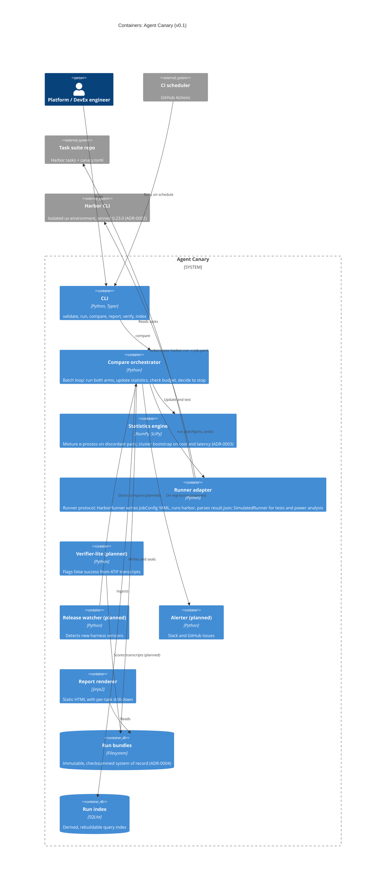
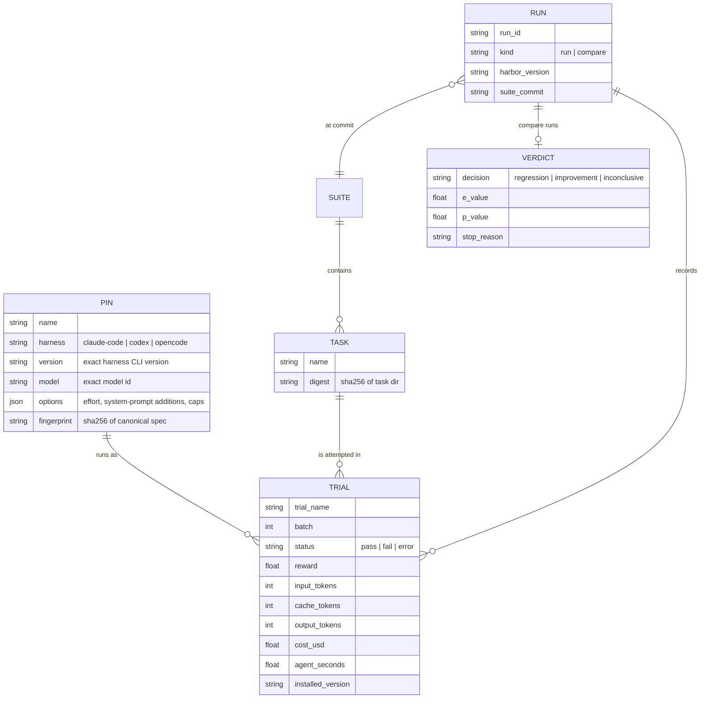

# C4 level 2: containers

v0.1 ships as one Python process (the `canary` CLI) plus the separately locked Harbor tool environment. The boxes inside the canary are modules, not services. They are drawn separately because each has its own contract and its own ADR. Items marked *planned* are in the v0.1 scope but are not built yet.

## Data model: the version matrix

A pin is one cell of the version matrix. Comparing two pins that differ in exactly one dimension, such as the harness version with the model held fixed, attributes a regression to that dimension. That is the harness-versus-model distinction model-only trackers cannot make.
