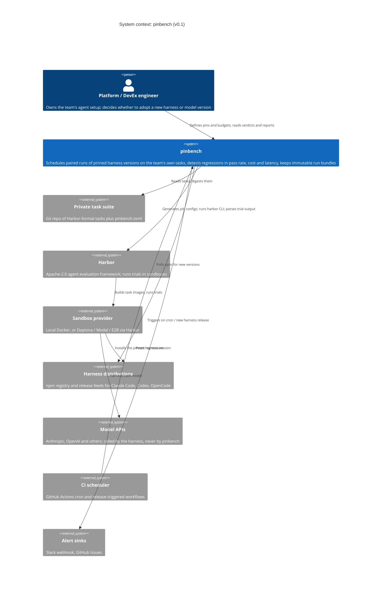

# C4 level 1: system context

pinbench sits between a team's private task suite and the coding-agent harnesses the team depends on. It never hosts anything. It runs where the team runs it: a laptop, a CI runner, or a scheduled GitHub Actions workflow.

## Trust and cost boundaries

- **Secrets.** Model API keys pass from the operator's environment to Harbor to the sandbox. pinbench records their names, never their values (ADR-0004).
- **Spend.** All token spend happens inside the sandbox, through the harness. pinbench controls spend by deciding whether to start another batch (ADR-0003), and by passing per-trial caps such as Claude Code's `max_budget_usd`.
- **Network.** The sandbox needs egress to the npm registry or Anthropic's installer, and to the model API. pinbench itself makes only small HTTPS requests: npm release checks and alerts.
